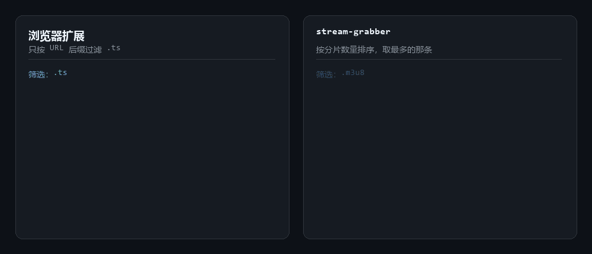
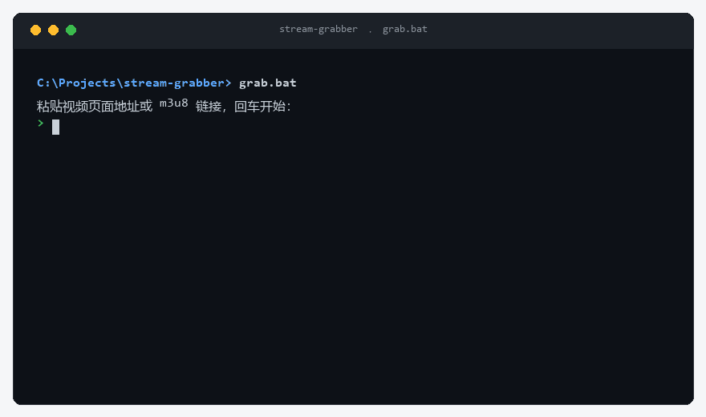

# stream-grabber

把网页里的视频存到本地。浏览器扩展负责在页面里找到播放地址和登录态，本地 Python 服务负责调用 `yt-dlp` 下载分片、`ffmpeg` 合并成 mp4。

支持 HLS（m3u8）页面嗅探；页面不是 HLS（DASH / mpd，如 B 站、YouTube）时，自动回落到 `yt-dlp` 的站点解析器。

Python 3.8+ · Chrome / Edge 110+ · MIT



---

## 特性

- **复用日常登录态。** 扩展直接向浏览器要 cookie，不用另开一个浏览器重新登录。
- **自动区分正片与贴片广告。** 挨个数播放列表的分片数：正片通常上千片，广告只有几十片，取最多的那条。
- **候选并发探测。** 一次页面常挂着多条流地址，服务并发拉取播放列表，返回分片数、分辨率、码率，按分片数降序排列。
- **多线程下载 + 自动合并。** `yt-dlp -N 16` 拉分片，`ffmpeg` 合并，格式优先 H.264（AV1 / HEVC 在部分播放器和剪辑软件里不认）。
- **断点续传。** 中断后重跑同一条命令，`yt-dlp` 读 `.part` 文件接着拉。
- **命令行独立可用。** 不装扩展也能用：自动启动一个带调试端口的浏览器嗅探页面，也支持直接喂 m3u8 直链。
- **纯本地。** 服务只监听 `127.0.0.1`，只接受本机请求；cookie 写成临时文件交给 `yt-dlp`，任务结束即删除。

---

## 工作原理

```
日常浏览器（已登录）
  └─ 扩展 popup
       ├─ 扫描页面已加载的资源，收集 m3u8 / mpd 候选地址
       ├─ 读取该站点的 cookie
       └─ POST →  127.0.0.1:8765
                     │
              本地服务 server.py
                ├─ /api/probe  并发拉播放列表，数分片、拆清晰度、排序
                ├─ /api/grab   写临时 cookie 文件，任务进入队列
                └─ yt-dlp 多线程下载 → ffmpeg 合并 → 删除 cookie 文件
                                                     │
                                                  下载目录
```

职责这样切的三个原因：

- **扩展只能看，不能下。** Chrome 的下载 API 一次只能存一个文件，而一条 HLS 流是上千个小分片，合并必须在浏览器之外做。
- **服务只能下，不能看。** 早先的版本让 Python 自己开浏览器嗅探，用的是独立配置目录，每个新站都要在里面重新登录一次。
- **不用 Native Messaging。** 那套方案要写注册表、把扩展 ID 和绝对路径写死；未上架的扩展 ID 每次加载可能变化。改用本机 HTTP 端口，Chrome 与 Edge 通用。

`127.0.0.1` 是回环地址，永远指向「运行它的那一台机器」，不是某台服务器的固定 IP。所以这个地址写死在代码里换到任何电脑都不需要改：扩展请求 `127.0.0.1:8765`，连的就是**用户自己电脑上**的 `server.py`。换机器时唯一要做的是在那台机器上重新装一遍扩展、起一次服务，两边不需要任何通信配置。

---

## 环境要求

| 项 | 要求 |
| --- | --- |
| 系统 | Windows 10/11（提供 `.bat` 一键脚本）；macOS / Linux 可用 `grab.sh`，需自行安装依赖 |
| Python | 3.8 及以上 |
| 浏览器 | Chrome 或 Edge，版本 ≥ 110（Manifest V3） |
| 外部工具 | `yt-dlp`、`ffmpeg`，可用 `setup_tools.py` 自动安装 |

Python 依赖只有 `websocket-client`（命令行嗅探用），本地服务本身只用标准库。

---

## 快速开始

### 1. 获取代码

```bash
git clone https://github.com/Zephyr-Wing/stream-grabber.git
cd stream-grabber
```

没装 Git 的话，在仓库页面点 `Code` → `Download ZIP`，解压后进入该目录执行后续命令。后面所有命令都在这个目录下运行，`config.json` 里的相对路径也以它为基准。

### 2. 安装依赖与外部工具

```bash
pip install -r requirements.txt
python setup_tools.py     # Windows：把 yt-dlp.exe 和 ffmpeg 下载到 tools/
```

`setup_tools.py` 从 GitHub 直连下载，失败会自动切镜像，也可以手动指定：

```bash
python setup_tools.py --mirror https://gh-proxy.com/
```

macOS / Linux 不走这个脚本：

```bash
brew install yt-dlp ffmpeg                     # macOS
sudo apt install ffmpeg && pip install yt-dlp  # Debian / Ubuntu
```

### 3. 加载扩展

双击 `install_extension.bat`，或在浏览器里手动操作：

1. 地址栏打开 `chrome://extensions`（Edge 为 `edge://extensions`）
2. 打开右上角「开发者模式」
3. 点「加载已解压的扩展程序」，选择仓库中的 `extension` 文件夹

工具栏出现蓝色下载图标即成功（没有的话在拼图菜单里钉住）。

两点需要知道：

- **开发者模式必须一直开着。** Chrome 134 起，关闭开发者模式会立刻停用所有以这种方式加载的扩展，没有提示。
- **启动时会提示「停用开发者模式扩展」。** 这是针对未上架扩展的固定提示，点「保留」即可，不是报错。

### 4. 启动本地服务

```bash
python server.py           # 或双击 server.bat
```

窗口保留、最小化即可，关闭后扩展无法下载。重复启动不会起第二个实例，只会报告已在运行的端口和版本。

若希望随系统启动，可把 `server.bat` 的快捷方式放入 `Win+R` → `shell:startup`。

**为什么不用商店安装。** 本项目只通过 GitHub 分发，需要用户自己「加载已解压的扩展」，没有上架 Chrome Web Store：

- 商店要求单一用途、权限最小化，而本扩展需要 `<all_urls>`、`cookies`、`webRequest` 才能读取任意页面的资源列表与登录态，属于审核重点。
- 视频下载类工具被投诉、下架的先例不少，一旦下架，已有用户会直接失去扩展；GitHub 分发没有这个风险。
- 项目仍在快速迭代，商店每次更新都要重新走 1–3 天的审核。

代价是用户要容忍开发者模式的提示。若后续上架，需要准备隐私政策页面、权限必要性说明、128×128 图标与截图，以及一次性 5 美元的开发者注册费。

---

## 使用

### 扩展模式

1. 打开视频页面，让视频播放几秒
2. 点击扩展图标
3. 列表第一条即正片，点右侧 `↓`

文件保存到配置中的 `out_dir`，默认 `downloads/`。

列表每行显示：清晰度徽标（`1080p` / `HLS` / `DASH`）、分片数、CDN 域名。分片数是最可靠的判断依据——贴片广告的分片只有几十个。

页面有两种情况：

| 页面拉流方式 | 列表表现 | 操作 |
| --- | --- | --- |
| HLS（m3u8） | 列出所有候选，按分片数排序 | 点 `↓` 下载选中的那一条 |
| DASH（mpd / `.m4s`） | 列表为空，顶部按钮高亮 | 点「下载这个页面」，交给 `yt-dlp` 站点解析器 |

判断方法：开发者工具 → 网络面板 → 过滤 `m3u8`。有就走第一条；只有 `.mpd`、`.m4s`，走第二条。

扩展面板下方显示最近 3 个任务，每 1.2 秒刷新一次进度。

### 命令行模式

不装扩展也能用，服务不必启动。

```bash
python grab.py https://cdn.example.com/hls/xxxx.m3u8
python grab.py https://example.com/videos/abc/
python grab.py https://example.com/videos/abc/ --list     # 只解析地址，不下载
```

Windows 也可以双击 `grab.bat`，粘贴链接回车。



流程：

```
grab.py
 ├─ 输入是 m3u8 直链  → 探测可用 Referer（裸请求 → 配置映射 → 站点根域 → 带 www → CDN 域名）
 └─ 输入是页面地址    → 启动 / 附着带调试端口的浏览器，CDP 监听网络请求
                        自动点播放，取分片数最多的一条 m3u8
                        └─ 没有 m3u8 → 回落 yt-dlp 站点解析器
```

默认使用仓库下的 `.chrome-profile` 作为浏览器配置，首次需要在这个窗口里登录一次；登录态会一直保留。若已经用 `chrome-debug.bat` 开着调试端口，`grab.py` 会直接附着上去，不用关闭浏览器。

参考命令：

```bash
# 只解析地址，先确认抓到的是正片还是广告
python grab.py <地址> --list

# 页面需要代理才能打开（下载仍走直连）
python grab.py <地址> --proxy http://127.0.0.1:7897

# 页面和下载都走代理
python grab.py <地址> --via-proxy

# 用一次性配置，不带任何登录态
python grab.py <地址> --guest
```

参数可以直接跟在地址后面，`grab.bat` 里整行粘贴也能正确拆分。

#### 参数

| 参数 | 说明 |
| --- | --- |
| `-n, --name` | 保存文件名，不含扩展名 |
| `-o, --out` | 保存目录，覆盖配置中的 `out_dir` |
| `-c, --config` | 指定配置文件路径 |
| `-t, --threads` | 并发分片数，默认 16 |
| `--list` | 只解析播放地址，不下载 |
| `--proxy URL` | 打开页面时使用的代理 |
| `--no-proxy` | 解析页面时不走代理 |
| `--via-proxy` | 下载阶段也走代理（默认直连） |
| `--cookies BROWSER` | 让 `yt-dlp` 读取浏览器 cookie 库，如 `chrome`；要求该浏览器已关闭 |
| `--guest` | 使用一次性浏览器配置，不携带登录态 |
| `--cdp-port PORT` | 连接指定调试端口的浏览器，如 `9222`；默认自动探测 |
| `--no-fallback` | 嗅探不到 m3u8 时直接退出，不回落 `yt-dlp` |

---

## 更新

```bash
git pull
python setup_tools.py      # 可选：同步更新 yt-dlp / ffmpeg
```

改了 `extension/` 里的文件，需要到 `chrome://extensions` 点该扩展卡片上的刷新按钮，然后重开扩展开关的面板；改了 `server.py` 或 `sgrab/`，重启 `server.bat` 即可。

`config.json` 不在版本控制内，`git pull` 不会覆盖它。

---

## 配置

```bash
cp config.example.json config.json
```

不建配置文件也能运行，缺失项使用默认值。命令行与本地服务读同一份配置。

| 键 | 默认 | 说明 |
| --- | --- | --- |
| `tools_dir` | `tools` | `yt-dlp` / `ffmpeg` 所在目录 |
| `out_dir` | `downloads` | 下载目录，建议填绝对路径，如 `D:/Videos` |
| `threads` | `16` | 并发分片数。网络差降到 8，跨境线路可试 24–32 |
| `retries` | `10` | 整体重试次数 |
| `fragment_retries` | `30` | 单个分片重试次数 |
| `socket_timeout` | `20` | 连接超时（秒） |
| `proxy` | `"auto"` | `auto` 自动探测常见本地端口；`null` 不用；也可填 `7897` 或完整地址 |
| `download_via_proxy` | `false` | 下载阶段是否也走代理 |
| `server_port` | `8765` | 服务端口，修改后需同步改 `extension/popup.js` 中的 `API` 常量 |
| `browser_profile` | `""` | 命令行嗅探使用的浏览器配置目录，留空即 `.chrome-profile` |
| `cdp_port` | `9222` | 命令行优先探测的调试端口 |
| `referer_map` | `{}` | 防盗链映射，CDN 域名 → 来源页候选列表 |

相对路径以**仓库根目录**为基准，不是相对 `config.json`。

`referer_map` 用于 CDN 域名与站点域名完全不同的情况，自动猜测猜不中时写死：

```json
{
  "referer_map": {
    "cdn-a.example.com": ["https://www.example.com/"],
    "cdn-b.example.net": ["https://example.com/", "https://m.example.com/"]
  }
}
```

---

## HTTP API

服务只监听 `127.0.0.1`，仅接受来自 `127.0.0.1` / `::1` 的请求，其他来源返回 403。

| 方法 | 路径 | 说明 |
| --- | --- | --- |
| GET | `/api/ping` | 服务信息：版本、`out_dir`、`threads`、`yt-dlp`/`ffmpeg` 是否就绪 |
| GET | `/api/jobs` | 任务列表（按创建时间倒序，单条含最近 12 行日志） |
| GET | `/api/job?id=<id>` | 单个任务详情（最近 80 行日志） |
| POST | `/api/probe` | 入参 `{urls: [{url, referer}], ua}`；返回分片数、是否 master、清晰度列表 |
| POST | `/api/grab` | 入参 `{url, referer, title, name, cookies, ua, mode}`；`mode` 为 `hls` 或 `page` |

任务在内存中保存最近 30 条，日志每任务保留 400 行；下载串行执行，避免多任务互相抢带宽、触发 CDN 限流。

---

## 目录结构

```
stream-grabber/
├── extension/           浏览器扩展（MV3）
│   ├── manifest.json
│   ├── background.js    网络层记录 m3u8 / mpd（含 XHR 拼接、SW 转发的请求）
│   ├── popup.html       扩展面板
│   ├── popup.js         资源扫描、候选合并、提交与进度轮询
│   └── icons/
├── server.py            本地下载服务，扩展调它
├── grab.py              命令行入口
├── sgrab/
│   ├── config.py        配置加载、工具定位、代理与调试端口探测
│   ├── referer.py       防盗链探测
│   └── sniffer.py       CDP 浏览器嗅探、cookie 导出
├── setup_tools.py       安装 yt-dlp + ffmpeg 到 tools/
├── server.bat           启动本地服务
├── grab.bat / grab.sh   启动命令行
├── chrome-debug.bat     启动带 9222 调试端口的专用浏览器
├── install_extension.bat  扩展安装引导
├── config.example.json
├── demo/                README 动图
├── .chrome-profile/     专用浏览器配置（存登录态；整体删除只会丢失登录，浏览器会自动重建）
└── tools/               运行时生成（不入库）
```

---

## 已知限制

- **DRM 内容无法处理。** 腾讯视频、爱奇艺、优酷、Netflix 等使用 Widevine / PlayReady，分片是密文，密钥不在客户端。
- **不支持直播流。** 仅处理点播。
- **清晰度受账号权限限制。** 工具只能把登录态原样带过去，站点给匿名用户的上限它改不了。
- **防盗链需要手工补映射。** CDN 与站点不同域时，需在 `referer_map` 中登记来源页。
- **签名有时效。** 部分站点（如抖音网页版）的分片地址带签名，几分钟后失效。
- **站点改版可能失效。** 这类工具的通病，不是 bug。
- **权限较大。** 扩展需要「读取和更改所有网站上的数据」，才能读取任意页面的资源列表与 cookie；相关代码全部在 `extension/` 内，可自行审阅。

---

## 常见问题

**扩展显示「本地服务没开」**
`server.bat` 窗口被关闭或尚未启动。重新运行 `python server.py`。

**列表为空**
视频还没开始加载，先播两秒再点扩展。若始终为空，检查网络面板过滤 `m3u8` 是否有结果：没有则改走「下载这个页面」。

**点击下载后任务不出现**
查看服务窗口的报错。最常见原因是未安装 `yt-dlp`，重新运行 `python setup_tools.py`。

**返回 403**
命令行加 `--list`，观察 Referer 探测结果。CDN 与站点不同域时，在 `config.json` 的 `referer_map` 中补一条。

**页面能播，但下载 403 或超时**
浏览器走了系统代理，下载程序走直连，两条路径不一致。把 `download_via_proxy` 设为 `true`，`proxy` 填实际端口（如 `7897`）。

**画质比网页上低**
先确认网页上那一档是否真的可播。若可播，刷新页面后重新点扩展，让 cookie 重新读取一次。

**进度卡住或中断**
分片在重试，`socket_timeout` 20 秒、`fragment_retries` 30 次，超限才会报错。命令行中断后重跑同一命令即可续传；扩展任务需重新点一次。

**换一台电脑要改什么**
什么都不用改。`127.0.0.1` 在每台机器上都指向它自己，扩展和服务只要装在同一台电脑上就能通信。换机器后照常执行：装依赖 → 加载扩展 → 起服务。

**服务起不来，或提示端口被占用**
`8765` 被别的程序占了会直接报错退出。可以改 `config.json` 里的 `server_port`，但 `extension/popup.js` 第 1 行的 `API` 常量必须同步改，否则扩展连不上。

**扩展点开是空白 / 显示服务未启动**
先确认服务窗口还在（`http://127.0.0.1:8765/api/ping` 能返回 JSON 即为正常），再确认扩展的「开发者模式」没有被关掉。

---

## 免责声明

本项目仅用于个人学习、技术研究与备份自己有权保存的内容。使用者需自行确认行为符合当地法律及目标站点的服务条款，不得用于批量抓取、二次分发或商业用途。作者不承担由此产生的任何后果。

若内容创作者提供官方下载渠道，请优先使用官方渠道。

## License

[MIT](LICENSE)
